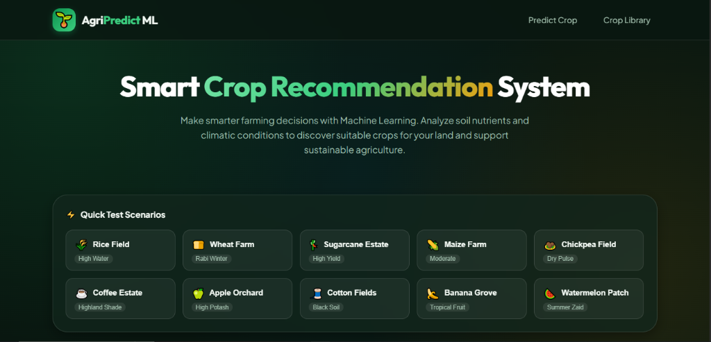
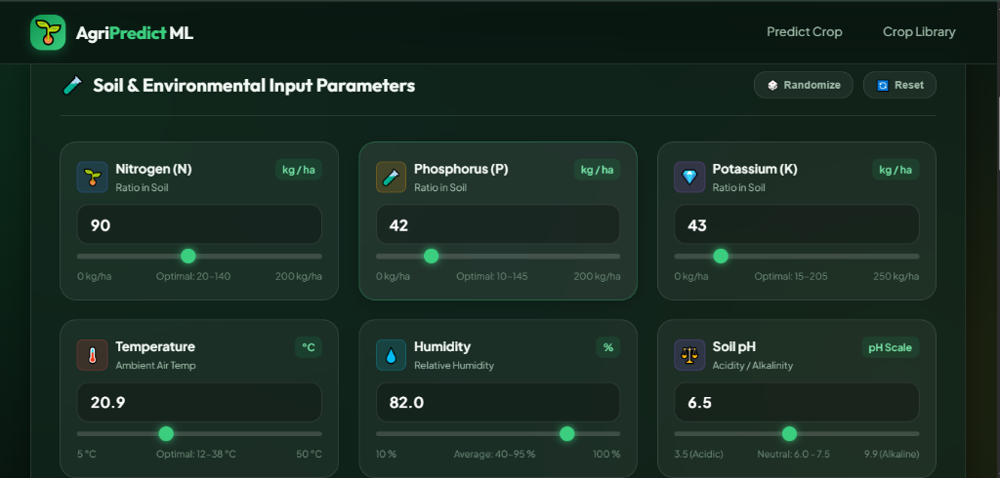
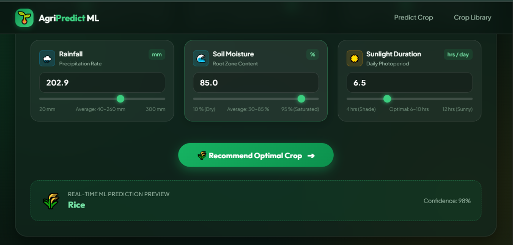
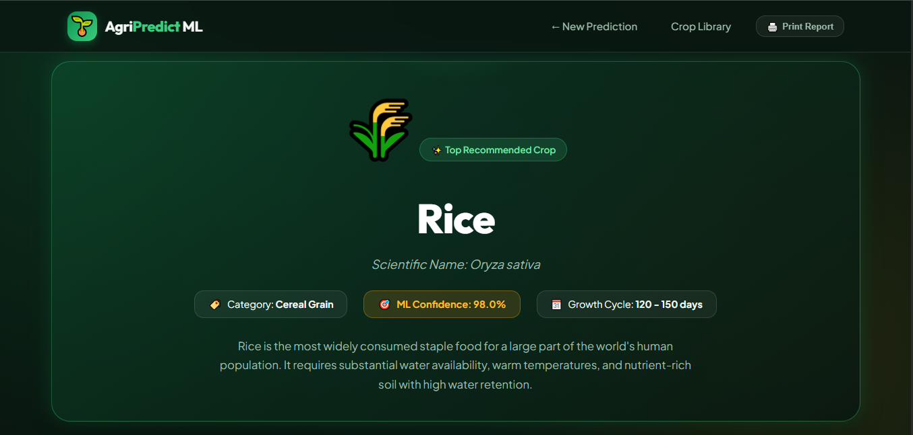
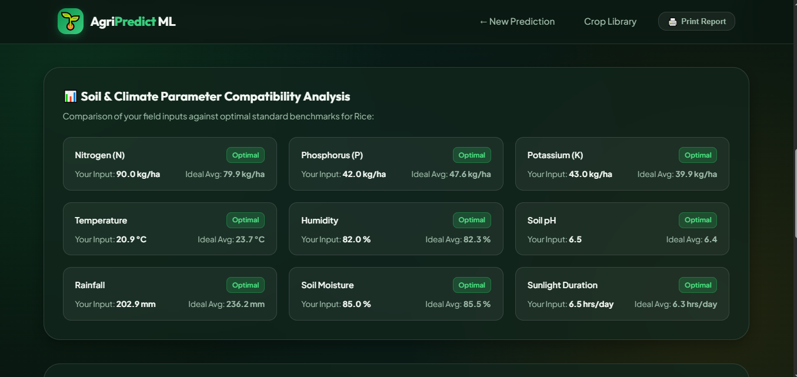
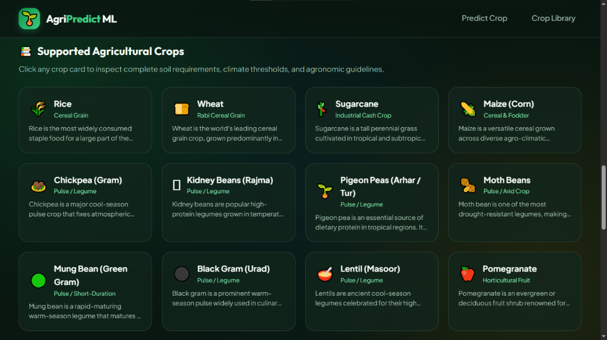
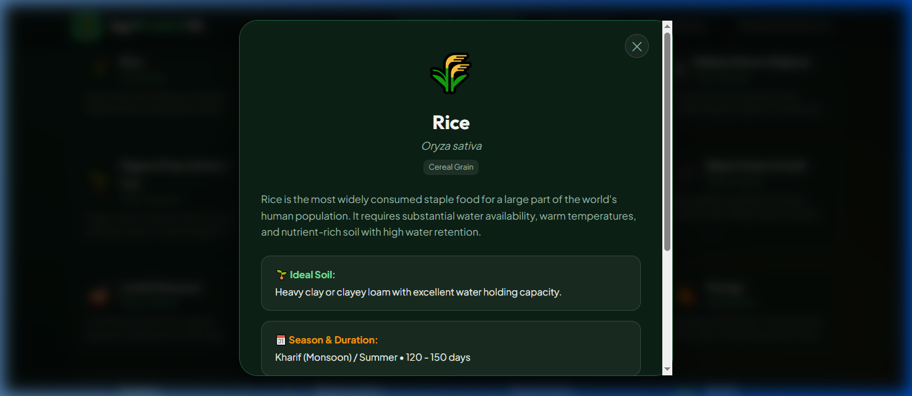
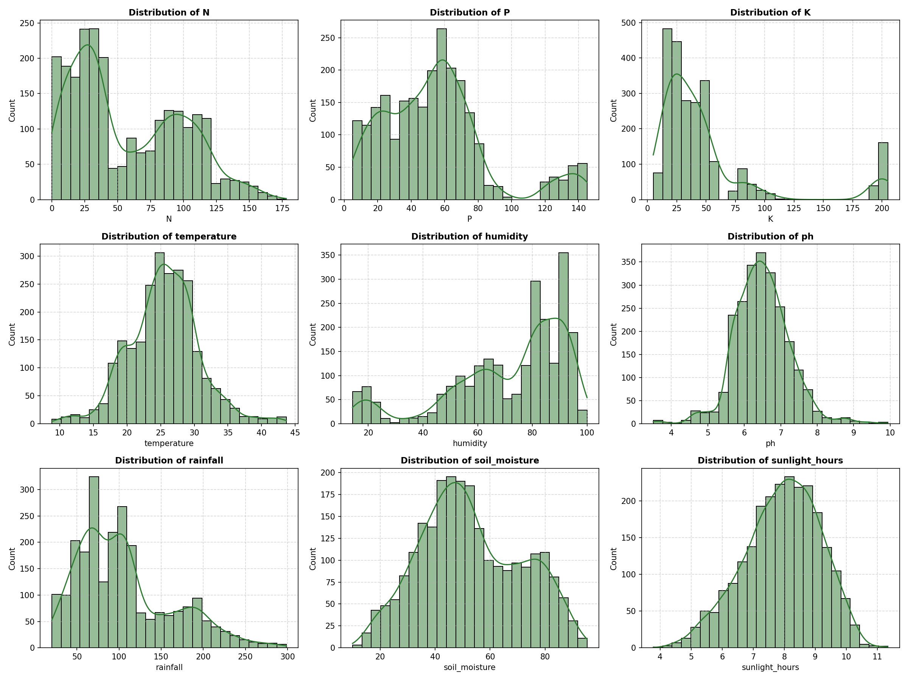
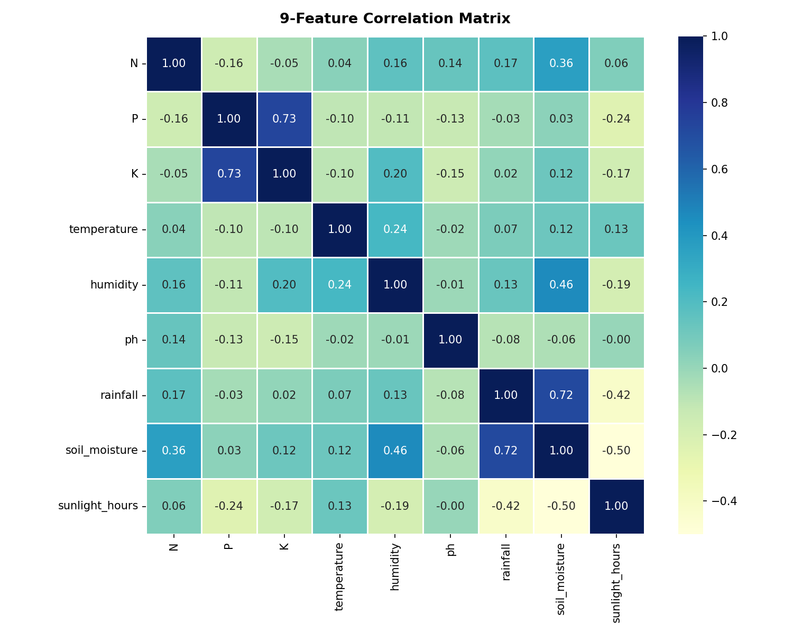

# 🌱 Smart Crop Recommendation System Using Machine Learning

> **Intelligence for Agriculture. Insights for Better Farming.**  
> A machine learning-powered decision support platform that recommends the most suitable and profitable crop based on soil chemical composition, moisture levels, and climatic conditions.

---

## 📑 Table of Contents

- [Overview](#-overview)
- [Project Features](#-project-features)
- [Problem Statement](#-problem-statement)
- [Tools and Technologies](#-tools-and-technologies)
- [System Architecture](#-system-architecture)
- [Repository Architecture](#-repository-architecture)
- [How to Run this Project](#-how-to-run-this-project)
- [Application Screenshots](#-application-screenshots--visual-demonstrations)
- [Results & Conclusion](#-results--conclusion)
- [Author & Contact](#-author--contact)

---

## 🌾 Overview

The **Smart Crop Recommendation System** is designed to assist farmers, agronomists, and agricultural researchers in making informed, data-driven crop selection decisions. By analyzing key soil nutrient indicators (**Nitrogen, Phosphorus, Potassium**), environmental parameters (**Temperature, Humidity, Soil pH, Rainfall**), and critical agro-ecological metrics (**Soil Moisture, Sunlight Duration**), the system predicts the optimal crop to cultivate from a diverse portfolio of **24 distinct agricultural crop classes**.

Powered by a **Random Forest Classifier** trained on stratified agricultural datasets, the system achieves **99.58% prediction accuracy**, offering instant predictions through an interactive, responsive web interface built with Flask and modern CSS.

---

## ✨ Project Features

1. **9-Parameter Comprehensive Analysis:**
   - Evaluates **Nitrogen ($N$)**, **Phosphorus ($P$)**, **Potassium ($K$)**, **Temperature**, **Humidity**, **Soil pH**, **Rainfall**, **Soil Moisture (%)**, and **Sunlight Duration (hrs/day)**.
2. **24 Supported Crop Classes:**
   - **Cereals:** Rice, Wheat, Maize (Corn)
   - **Pulses & Legumes:** Chickpea, Kidney Beans, Pigeon Peas, Moth Beans, Mung Bean, Black Gram, Lentil
   - **Fruits & Horticulture:** Pomegranate, Banana, Mango, Grapes, Watermelon, Muskmelon, Apple, Orange, Papaya
   - **Plantation & Cash Crops:** Sugarcane, Coconut, Cotton, Jute, Coffee
3. **High-Accuracy ML Model:**
   - **99.58% test accuracy** with $0.95\text{--}1.00$ Precision, Recall, and F1-scores across all 24 classes.
4. **Interactive Web Interface:**
   - Dual-input control system pairing numeric inputs with synchronized range sliders.
   - **10 Quick Test Scenarios (Presets):** Instant 1-click test profiles for Rice, Wheat, Sugarcane, Maize, Chickpea, Coffee, Apple, Cotton, Banana, and Watermelon.
   - Randomize and Reset controls for testing different soil configurations.
5. **Real-Time Live Prediction Preview:**
   - Debounced REST API (`/api/predict`) provides instant predictions as inputs are adjusted.
6. **Agronomic Compatibility & Guidance:**
   - **9-Factor Parameter Fit Meters:** Visual indicator comparing field inputs against standard benchmarks (Optimal, Moderate, Suboptimal).
   - **5 Agronomy Guidance Cards:** Soil Requirements, Seasonal Timing, Irrigation Strategy, Fertilizer Management, and Economic Outlook.
   - **Secondary Viable Alternatives:** Displays top alternative crops based on model probability distributions.
7. **Print-Ready Farm Report:**
   - Built-in print/PDF stylesheet (`window.print()`) for offline agricultural documentation.
8. **Interactive 24-Crop Encyclopedia:**
   - Searchable crop library with modal popups providing complete botanical and cultivation data.

---

## ❗ Problem Statement

Traditional agricultural practices often rely on trial-and-error, historical habit, or generalized regional suggestions rather than precise soil chemistry and microclimate conditions. This leads to critical challenges:

- **Suboptimal Crop Selection:** Planting crops ill-suited to soil nutrient profiles results in stunted growth, lower crop yields, and financial losses for farmers.
- **Excessive & Inefficient Fertilizer Usage:** Lack of precision leads to over-application of synthetic fertilizers, causing soil degradation, groundwater contamination, and inflated input costs.
- **Climate Vulnerability:** Shifting weather patterns, unseasonal rainfall, and moisture stress require dynamic, data-backed crop choices.
- **Information Accessibility Gap:** Smallholder farmers frequently lack access to accessible, automated agronomic decision-support tools.

**Solution:** This project addresses these challenges by delivering an accessible, AI-powered system that transforms raw soil and climate parameters into actionable crop recommendations and agronomic management plans.

---

## 🛠️ Tools and Technologies

| Category | Technology | Purpose |
| :--- | :--- | :--- |
| **Programming Language** | Python 3.9+ | Backend application logic and machine learning pipeline |
| **Machine Learning** | Scikit-learn | Random Forest classifier training, hyperparameter tuning, evaluation |
| **Data Processing** | Pandas, NumPy | Dataset cleaning, normalization, statistical preprocessing |
| **Data Visualization** | Matplotlib, Seaborn | Exploratory Data Analysis (EDA) distribution charts & correlation heatmaps |
| **Model Serialization** | Joblib | Serializing and loading the trained model payload (`crop_model.pkl`) |
| **Backend Web Framework** | Flask 3.x | Routing, input validation, template rendering, and RESTful API |
| **Frontend Structure** | HTML5 | Semantic markup, accessible forms, and modal dialogs |
| **Frontend Styling** | Vanilla CSS3 | Emerald glassmorphism design system, grid layouts, animations |
| **Client Scripting** | JavaScript (ES6+) | Dual slider-input synchronization, AJAX preview, modal viewer |

---

## 🏗️ System Architecture

```text
                        ┌────────────────────────┐
                        │      FARMER / USER     │
                        └───────────┬────────────┘
                                    │
                                    ▼
                        ┌────────────────────────┐
                        │   WEB USER INTERFACE   │
                        │   (HTML5, CSS3, JS)    │
                        └───────────┬────────────┘
                                    │
                                    ▼
                        ┌────────────────────────┐
                        │     INPUT PARAMETERS   │
                        │  9 Soil & Climate Vars │
                        └───────────┬────────────┘
                                    │ HTTP POST / AJAX
                                    ▼
                        ┌────────────────────────┐
                        │     FLASK BACKEND      │
                        │       (app.py)         │
                        └───────────┬────────────┘
                                    │
                                    ▼
                        ┌────────────────────────┐
                        │    INPUT VALIDATION    │
                        │  Type & Range Checking │
                        └───────────┬────────────┘
                                    │ Validated Vector
                                    ▼
                        ┌────────────────────────┐
                        │   TRAINED ML MODEL     │
                        │ (Random Forest .pkl)   │
                        └───────────┬────────────┘
                                    │
                                    ▼
                        ┌────────────────────────┐
                        │   PREDICTION ENGINE    │
                        │ Class Probabilities &  │
                        │ Parameter Fit Analysis │
                        └───────────┬────────────┘
                                    │
                                    ▼
                        ┌────────────────────────┐
                        │     RESULT DISPLAY     │
                        │ Top Crop, Agronomy     │
                        │ Cards & Viable Alts    │
                        └────────────────────────┘
```

### Process Flow
1. **User Input:** User inputs 9 soil/climate parameters or selects a 1-click test scenario.
2. **Backend Processing:** Flask receives the request, validates numerical boundaries, and prepares the feature array.
3. **ML Inference:** The trained Random Forest model predicts the crop class and extracts confidence probabilities.
4. **Agronomic Mapping:** The backend correlates user parameters with empirical crop benchmarks and generates suitability badges.
5. **Presentation:** The result page presents the recommended crop, scientific profile, compatibility meters, alternatives, and actionable farming advice.

---

## 📁 Repository Architecture

```text
Crop-Recommendation-ML/
│
├── app.py                      # Flask web application, route handlers, and API endpoints
├── train_model.py              # ML data preprocessing, Random Forest training & evaluation
├── Crop_recommendation.csv     # Agricultural dataset (2,400 samples, 24 crops, 9 features)
├── crop_model.pkl              # Serialized Random Forest model artifact
│
├── templates/
│   ├── index.html              # Homepage with 9-parameter form, 10 presets & crop library
│   └── result.html             # Recommendation report with agronomy cards & 3x3 fit meters
│
├── static/
│   ├── style.css               # Precision agriculture emerald glassmorphism stylesheet
│   ├── script.js               # Dual input synchronization, presets loader & AJAX engine
│   └── img/
│       ├── screenshots/        # Application interface & recommendation result screenshots
│       └── eda/                # Generated EDA distribution and correlation matrix plots
│
├── requirements.txt            # Python dependencies
└── README.md                   # Project documentation
```

### Key File Descriptions

| File | Purpose |
| :--- | :--- |
| `app.py` | Runs the Flask server, performs input validation, executes inference, and serves web/API routes. |
| `train_model.py` | Preprocesses `Crop_recommendation.csv`, generates EDA visualizations, trains the Random Forest classifier, and saves `crop_model.pkl`. |
| `Crop_recommendation.csv` | Dataset containing 2,400 records (100 samples per crop across 24 crops) with 9 features. |
| `crop_model.pkl` | Serialized model payload containing the trained model, feature names, classes, and metadata. |
| `templates/index.html` | Frontend template featuring dual slider inputs, 10 presets, and crop library. |
| `templates/result.html` | Recommendation result page with 3x3 compatibility meters and agronomy guidelines. |
| `static/style.css` | Custom responsive stylesheet with glassmorphic cards, custom sliders, and print layout. |
| `static/script.js` | Client-side scripting for dual slider sync, debounced real-time preview, and modal viewer. |

---

## 🚀 How to Run this Project

### 1. Prerequisites
- **Python:** Python 3.9, 3.10, 3.11, 3.12, or 3.13
- **Package Manager:** `pip`

### 2. Clone the Repository
```bash
git clone https://github.com/your-username/Crop-Recommendation-ML.git
cd Crop-Recommendation-ML
```

### 3. Create & Activate Virtual Environment (Recommended)
```bash
# Windows
python -m venv venv
.\venv\Scripts\activate

# macOS / Linux
python3 -m venv venv
source venv/bin/activate
```

### 4. Install Required Dependencies
```bash
pip install -r requirements.txt
```

### 5. Train the Machine Learning Model (Optional)
*A pre-trained `crop_model.pkl` is already included in the repository. To re-train from scratch:*
```bash
python train_model.py
```

### 6. Start the Flask Web Application
```bash
python app.py
```

### 7. Access the Application
Open your web browser and navigate to:
```
http://127.0.0.1:5000
```

---

## 🔌 API Documentation

### Predict Crop (`POST /api/predict`)
Send a JSON payload with the 9 parameters to receive an instant prediction:

**Request:**
```bash
curl -X POST http://127.0.0.1:5000/api/predict \
  -H "Content-Type: application/json" \
  -d '{
    "N": 105,
    "P": 55,
    "K": 40,
    "temperature": 18.5,
    "humidity": 58.0,
    "ph": 6.7,
    "rainfall": 70.0,
    "soil_moisture": 52.0,
    "sunlight_hours": 8.0
  }'
```

**Response:**
```json
{
  "success": true,
  "prediction": "wheat",
  "confidence": 100.0,
  "crop_info": {
    "display_name": "Wheat",
    "scientific_name": "Triticum aestivum",
    "category": "Rabi Cereal Grain",
    "season": "Rabi (Winter season)",
    "growth_duration": "110 - 140 days"
  },
  "alternatives": []
}
```

---

## 📸 Application Screenshots & Visual Demonstrations

### Figure 1: Homepage Hero & Quick Test Scenarios (10 Presets)

*Figure 1: Homepage featuring emerald glassmorphism styling, clean agricultural branding, and 10 one-click crop presets organized in a responsive [5 + 5] grid layout for rapid testing across cereals, pulses, fruits, and cash crops.*

---

### Figure 2: Soil & Environmental Input Parameters (9 Factors in 3×3 Grid)

*Figure 2: Upper input interface featuring dual synchronized number fields and range sliders for Nitrogen ($N$), Phosphorus ($P$), Potassium ($K$), Temperature, Humidity, and Soil pH, including Randomize and Reset controls.*

---

### Figure 3: Real-Time ML Prediction Preview & Recommendation Trigger

*Figure 3: Lower input parameters (Rainfall, Soil Moisture, Sunlight Duration), live debounced ML prediction preview badge ("Rice, Confidence: 98%"), and the "Recommend Optimal Crop" primary submission button.*

---

### Figure 4: Crop Recommendation Result Page & Cultivation Metrics

*Figure 4: Comprehensive recommendation results banner displaying the top predicted crop (Wheat), 100% confidence score, scientific name, growth duration, season, and primary action controls (Recalculate, Print Report, View Details).*

---

### Figure 5: Soil & Climate Parameter Compatibility Analysis (3×3 Benchmark Grid)

*Figure 5: Soil and climate parameter compatibility analysis grid evaluating user field inputs against empirical agronomic tolerances (Optimal vs. Moderate indicators across all 9 factors).*

---

### Figure 6: Supported Agricultural Crops Library (24 Classes Catalog)

*Figure 6: Interactive 24-crop encyclopedia catalog displaying botanical cards categorized into Cereals, Pulses & Legumes, Horticultural Fruits, and Plantation / Industrial Cash Crops.*

---

### Figure 7: Crop Agronomic Modal Dialog

*Figure 7: Modal dialog inspecting complete agronomic profile, scientific taxonomy, climate requirements, and ideal soil conditions.*

---

### Figure 8: Exploratory Data Analysis (EDA) — Feature Distribution Profiles

*Figure 8: Statistical distributions for Nitrogen, Phosphorus, Potassium, Temperature, Humidity, Soil pH, Rainfall, Soil Moisture, and Sunlight Duration across 2,400 dataset samples.*

---

### Figure 9: Exploratory Data Analysis (EDA) — Parameter Correlation Heatmap

*Figure 9: Pearson correlation matrix displaying inter-variable relationships across all 9 agricultural features.*

---

## 📈 Results & Conclusion

### Model Performance Metrics

| Evaluation Metric | Score |
| :--- | :--- |
| **Overall Accuracy** | **99.58%** |
| **Macro Average Precision** | **1.00** |
| **Macro Average Recall** | **1.00** |
| **Macro Average F1-Score** | **1.00** |
| **Test Set Support** | **480 samples (20 per class across 24 crops)** |

### Feature Importance Breakdown

The Random Forest feature importance analysis indicates the relative weight of each factor:

1. **Rainfall:** 19.15%
2. **Humidity:** 18.30%
3. **Potassium ($K$):** 16.81%
4. **Phosphorus ($P$):** 12.03%
5. **Soil Moisture:** 11.08%
6. **Nitrogen ($N$):** 9.68%
7. **Temperature:** 5.64%
8. **Sunlight Duration:** 4.14%
9. **Soil pH:** 3.17%

### Conclusion
The **Smart Crop Recommendation System** demonstrates how machine learning can be effectively applied to precision agriculture. By incorporating **9 soil and climatic parameters** across **24 crop classes**, the system provides accurate recommendations and agronomic guidance. The lightweight architecture operates without requiring an external database, making it easy to deploy for agricultural advisory.

---

## 👤 Author & Contact

- **Project Developer:** Kaustubh Bangar
- **Project Title:** Smart Crop Recommendation System Using Machine Learning
- **Domain:** Precision Agriculture, Machine Learning & Web Development

---

<div align="center">
  <sub>Smart Technology | Precision Agriculture | Sustainable Future</sub><br>
  <sub>© 2027 Smart Crop Recommendation System. All Rights Reserved.</sub>
</div>
